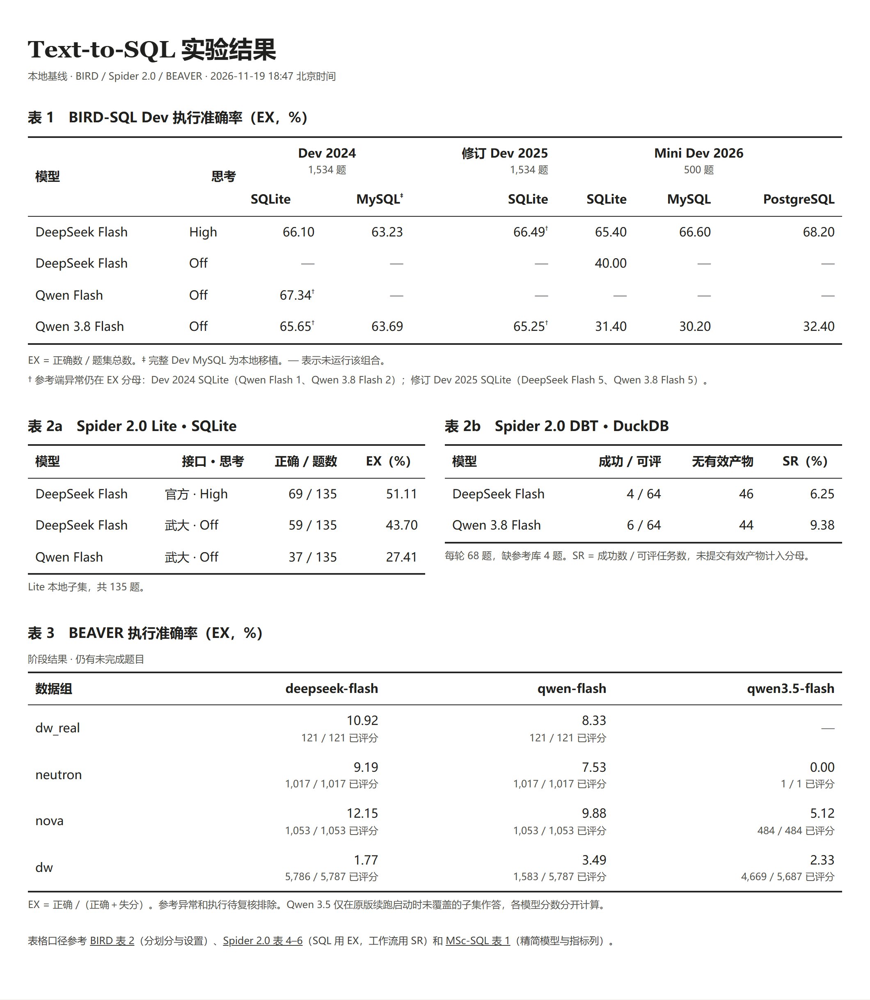

# 朱雅轩｜Text-to-SQL 论文实验

新人培养计划 · 第 3 轮 · 2026-11-19（北京时间）

## 数据集工作

整理 BIRD、Spider 2.0 和 BEAVER 的版本、数据组、数据库与评测环境，运行 DeepSeek 和 Qwen 基线，保存逐题 SQL、执行结果和评分。按数据组、方言、模型和运行设置汇总实验覆盖，核查失分与评分异常。

## 最新结果



[HTML 表格](reports/results_20261119.html) · [CSV](reports/results_20261119.csv) · [LaTeX booktabs](reports/results_20261119_booktabs.tex) · [第三轮实验分析](reports/round3_experiment_report.md)

## 复现入口

- [基线脚本与复现条件](experiments/round3/README.md)
- [BIRD Mini-Dev 固定输出与复现](docs/reproduce.md)
- [数据来源与版本](data/PROVENANCE.md)

```bash
python scripts/verify_results.py
```
